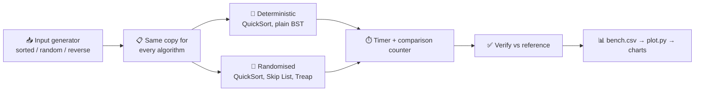
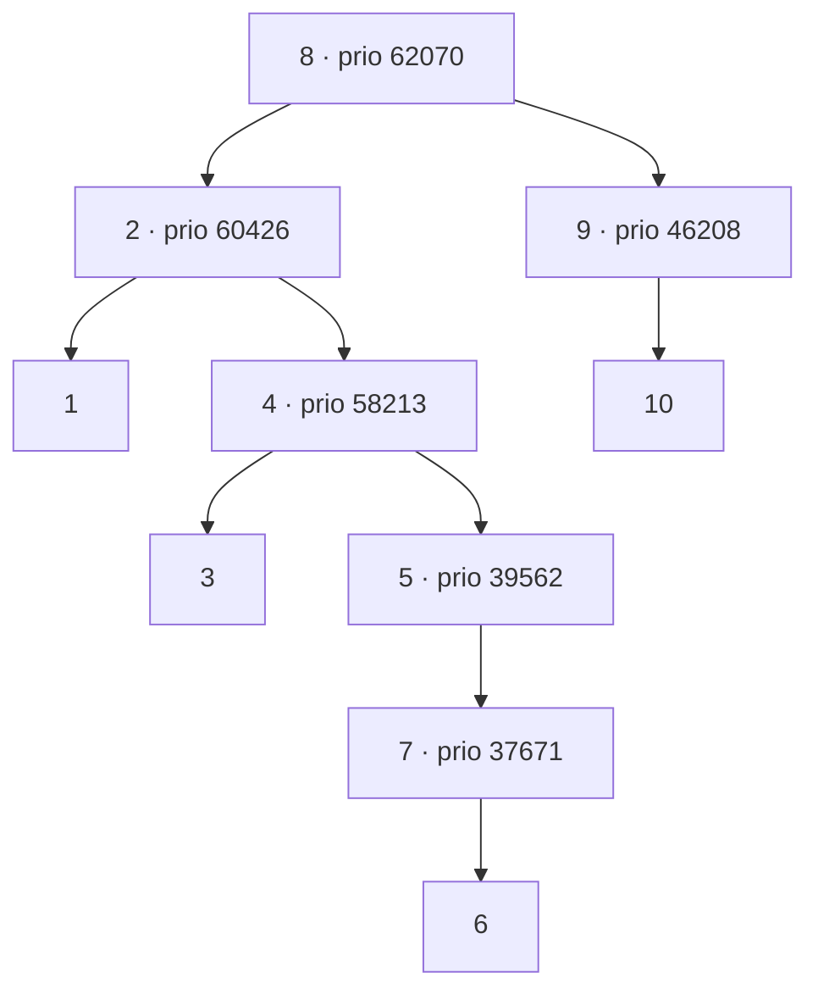
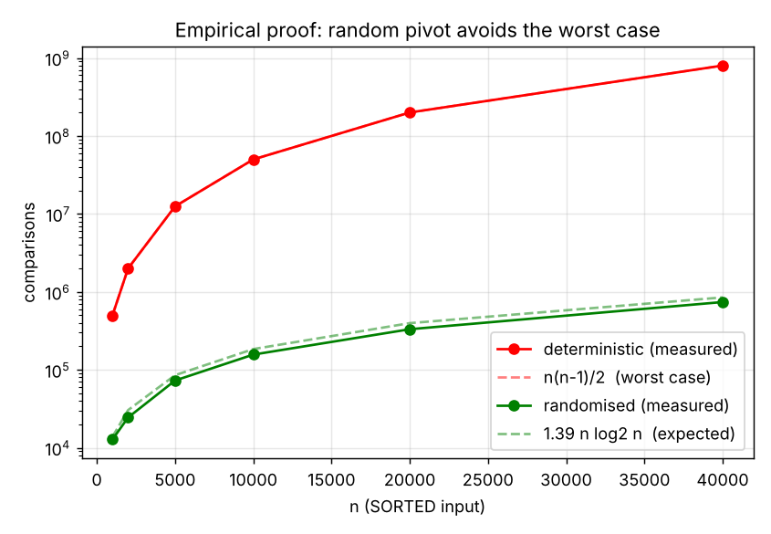
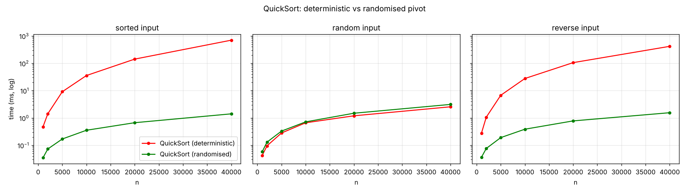
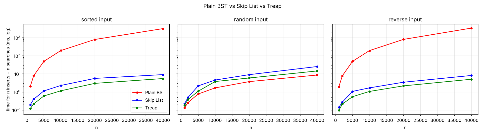
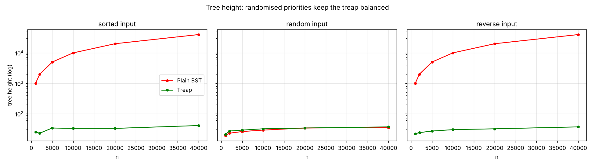
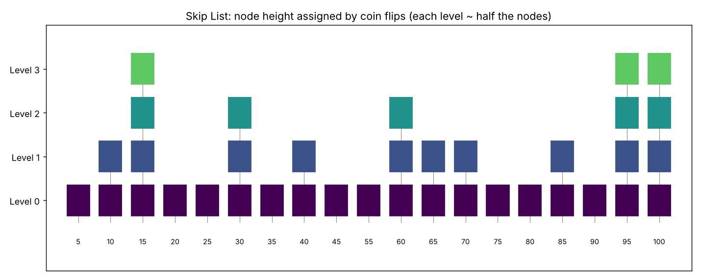
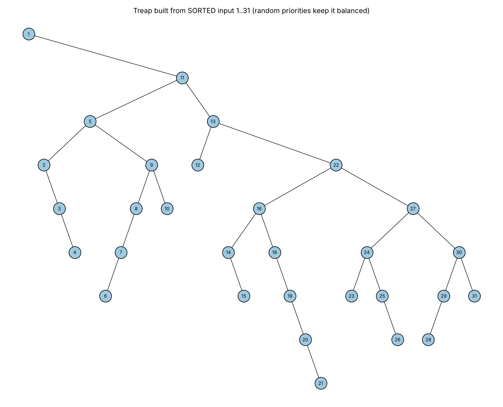

 🎲 Randomised QuickSort, Skip List & Treap in C


> **Design and Analysis of Algorithms (DAA) project** – three randomised algorithms and data structures implemented from scratch in C, then benchmarked against their deterministic counterparts on **sorted, random and reverse** data.

---

## 📑 Table of Contents
1. [Overview](#-overview)
2. [Features](#-features)
3. [Project Structure](#-project-structure)
4. [How It Works](#-how-it-works)
5. [Complexity](#-complexity)
6. [Getting Started](#-getting-started)
7. [Benchmark Results](#-benchmark-results)
8. [Visualisations](#-visualisations)
9. [Testing](#-testing)
10. [Worked Examples](#-worked-examples)
11. [Limitations & Future Work](#-limitations--future-work)
12. [Real-World Use](#-real-world-use)
13. [References](#-references)
14. [Author](#-author)

---

## 🔍 Overview

A deterministic algorithm always behaves the same on the same input, so some input always makes it slow. **Randomisation removes that weakness** – the running time depends on coin flips *inside* the algorithm, not on the input, so no fixed input can reliably trigger the worst case.

| 🧩 Structure | 🎲 Source of randomness | ⏱️ Expected cost | 🧱 Deterministic counterpart |
|---|---|---|---|
| **Randomised QuickSort** | random pivot | O(n log n) on *any* input | last-element pivot → O(n²) on sorted input |
| **Skip List** | coin-flip node heights | O(log n) search / insert / delete | plain BST (degenerates to a chain) |
| **Treap** | random heap priorities | O(log n) expected height | plain BST (degenerates to a chain) |

All three are **Las Vegas algorithms**: the answer is *always correct*, only the running time is random.

---

## ✨ Features

- ⚡ **Randomised QuickSort** with random pivot selection (recursion depth bounded to O(log n))
- 📉 **Empirical proof** that a random pivot avoids the worst case on sorted input
- 🪜 **Skip List** with probabilistic level assignment (p = 1/2, max 16 levels)
- 🌳 **Treap** – BST on keys + max-heap on random priorities, balanced with rotations
- 🏁 **Benchmarks** of everything on sorted / random / reverse data (n up to 40,000)
- 🎨 **Visualisations** of Skip List levels and Treap structure (matplotlib)
- ✅ **22 unit tests** checked against independent references (`qsort`, reference arrays, invariants)

---

## 📁 Project Structure

```
randomized-ds/
├── 📄 README.md              project documentation
├── 🛠️ Makefile               build / run / clean
├── 🐍 plot.py                draws all charts from results/
├── 🙈 .gitignore
├── 📂 src/
│   ├── ds.h                  shared structures + prototypes
│   ├── quicksort.c           deterministic + randomised QuickSort
│   ├── skiplist.c            Skip List (probabilistic levels)
│   ├── treap.c               Treap (BST + random heap priorities)
│   ├── bst.c                 plain BST – deterministic baseline
│   ├── main.c                demo + exports visualisation data
│   ├── test.c                22 unit tests
│   ├── example.c             fixed-seed worked examples
│   └── bench.c               benchmark → results/bench.csv
└── 📂 results/
    ├── bench.csv                    raw benchmark data
    ├── skiplist.txt, treap.txt      data for the visualisations
    ├── worst_case_proof.png         random pivot vs worst case
    ├── quicksort_time.png           QuickSort time (3 input types)
    ├── quicksort_comparisons.png    QuickSort comparison counts
    ├── ds_time.png                  BST vs Skip List vs Treap
    ├── tree_height.png              BST vs Treap height
    ├── skiplist_levels.png          Skip List visualisation
    └── treap_structure.png          Treap visualisation
```

---

## ⚙️ How It Works

### 🔄 Pipeline



### ⚡ 1. Randomised QuickSort

```
RandQuickSort(A, lo, hi):
    while lo < hi:
        r = random index in [lo, hi]
        swap A[r], A[hi]               # random element becomes the pivot
        p = Partition(A, lo, hi)       # Lomuto partition
        recurse on the SMALLER side, loop on the larger   # depth O(log n)
```

- Two elements are compared **at most once**, and only if one is picked as pivot before anything between them.
- That gives `E[comparisons] = 2(n+1)·Hₙ − 4n ≈ 1.39 n log₂ n` for **every** input order.
- A fixed pivot on sorted input makes every partition split off a single element → exactly **n(n−1)/2** comparisons.

### 🪜 2. Skip List

A sorted linked list with extra "express lanes". Each node gets a random height by repeatedly flipping a coin.

```
Level 3 :  HEAD ─────────────────────────► 60 ──────────────────────► NIL
Level 2 :  HEAD ──────────► 10 ──────────► 60 ──────────────────────► NIL
Level 1 :  HEAD ──────────► 10 ──────────► 60 ──────────────────────► NIL
Level 0 :  HEAD ► 10 ► 20 ► 30 ► 40 ► 50 ► 60 ► 70 ► 80 ► 90 ► 100 ► NIL
                                                 ▲
                              search(90): start at the top, go right while next < 90,
                              otherwise drop a level  →  only a few steps
```

- ~½ of the nodes reach level 1, ~¼ reach level 2, … → top level ≈ log₂ n.
- Heights do **not** depend on the keys, so insertion order cannot hurt it.
- Expected search path ≈ 2 log₂ n steps → **O(log n)** expected.

### 🌳 3. Treap (Tree + Heap)

```
        (key, priority)
              ┌───────── BST rule  : left keys < node key < right keys
   Treap  ────┤
              └───────── Heap rule : parent priority > children priorities
```

- Priorities are random, so the Treap equals a BST built from a **random insertion order**.
- Insert as a leaf, then **rotate up** while its priority beats its parent's.
- Expected depth of a key < 2 ln n; expected height ≈ 4.31 ln n − 1.95 ln ln n.


*Treap from the **sorted** keys 1..10 (seed 3): height 6, where a plain BST would be a chain of height 10.*

---

## 📐 Complexity

| Operation | 🎲 Randomised version | 🧱 Deterministic version | Worst case of deterministic |
|---|---|---|---|
| Sort n numbers | O(n log n) expected | O(n log n) on random data | **O(n²)** on sorted / reverse |
| Search | O(log n) expected (Skip List, Treap) | O(log n) on random order | **O(n)** (plain BST) |
| Insert | O(log n) expected | O(log n) on random order | **O(n)** (plain BST) |
| Delete | O(log n) expected | – | – |
| Extra space | O(n) (Skip List ≈ 2 pointers / node) | O(n) | – |

---

## 🚀 Getting Started

### 📋 Requirements
- `gcc` (or any C11 compiler) and `make`
- Python 3 with matplotlib → `pip install matplotlib`

### ▶️ Build & run

```bash
git clone https://github.com/yokeshsk/randomized-ds.git
cd randomized-ds

make             # build demo, bench, test, example
./test           # ✅ 22 unit tests
./example        # 🔢 fixed-seed worked examples
./demo           # 👀 demo + visualisation data
./bench          # 🏁 benchmarks → results/bench.csv  (~10 s)
python3 plot.py  # 📊 charts → results/
```

Or everything at once:

```bash
make run
```

> 🪟 **Windows without `make`?** Compile manually:
> `gcc -O2 -o bench src/bench.c src/quicksort.c src/skiplist.c src/treap.c src/bst.c`

---

## 🏁 Benchmark Results

Measured on one cloud Linux container, `gcc -O2`, single run per cell. Absolute times differ per machine – the **growth rates and ordering** are what matter.

### ⚡ QuickSort on **sorted** input (n = 40,000)

| Version | Comparisons | Time |
|---|---:|---:|
| 🧱 Fixed pivot (last element) | **799,980,000** (= n(n−1)/2) | 697.02 ms |
| 🎲 Random pivot | **741,138** | 1.41 ms |
| 🏆 Improvement | **≈ 1,079× fewer comparisons** | **≈ 495× faster** |

### 🌳 n inserts + n searches on **sorted** input (n = 40,000)

| Structure | Time | Height / levels |
|---|---:|---:|
| 🧱 Plain BST | 3,153.68 ms | 40,000 (a chain!) |
| 🌳 Treap | **5.45 ms** | 41 |
| 🪜 Skip List | **9.01 ms** | 16 levels |

### 🔀 Does the input order matter? (random pivot, n = 40,000)

| Input | Comparisons |
|---|---:|
| 📈 Sorted | 741,138 |
| 🔀 Random | 702,798 |
| 📉 Reverse | 733,454 |

➡️ Within ~6 % of each other – the random pivot's cost **does not depend on input order**.

### 💡 Key observations

- 🚨 Fixed pivot and plain BST turn **quadratic** on sorted and reverse input.
- 🛡️ Random pivot, Skip List and Treap stay near **O(n log n)** on every input type.
- ⚖️ On **random** input the plain BST is actually fastest (8.5 ms vs Treap 14.4 ms vs Skip List 25.2 ms) – randomisation buys *protection against bad inputs* at a small constant-factor cost.
- 🌲 Treap height at n = 40,000 is 37–41 (theory ≈ 41); a perfect tree would be 16.

---

## 🎨 Visualisations

| 📉 Proof: random pivot avoids the worst case | ⏱️ QuickSort time |
|:--:|:--:|
|  |  |

| 🌳 BST vs Skip List vs Treap | 📏 Tree height |
|:--:|:--:|
|  |  |

| 🪜 Skip List levels | 🌳 Treap structure (sorted 1..31) |
|:--:|:--:|
|  |  |

---

## ✅ Testing

Run with `./test` – **22 / 22 pass**.

| Area | What is checked |
|---|---|
| ⚡ QuickSort | equals `qsort` on 200 random arrays (both versions); sorted, reverse, duplicates, 1 element, empty range |
| 📉 Worst case | fixed pivot = exactly n(n−1)/2 on sorted input; random pivot uses < 1 % of that at n = 20,000 |
| 🪜 Skip List | search matches a reference array; keys increasing on every level; size; delete; missing-key delete; 100,000 sorted inserts stay ≤ 16 levels |
| 🌳 Treap | search matches reference; **BST + heap invariants** after inserts *and* deletes; 50,000 sorted inserts → height 37 (< 60) |
| 🧱 Plain BST | sorted inserts give height n (shows the baseline problem) |

---

## 🧪 Worked Examples

From `./example` (fixed seeds, reproducible):

**⚡ QuickSort on sorted 1..8** – fixed pivot: **28** comparisons · random pivot: **20**

**🪜 Skip List, keys 10…120 inserted in sorted order (seed 5)** – 4 levels; searching for 90 took only **3** rightward moves (a plain list needs 9).

**🌳 Treap, sorted keys 1..10 (seed 3)** – height **6** instead of 10 (see the diagram above).

---

## ⚠️ Limitations & Future Work

**Limitations**
- QuickSort uses the Lomuto partition → quadratic when *many keys are equal* (with either pivot rule).
- Each benchmark cell is a single run on one machine with the C library `rand()`.
- Skip List is capped at 16 levels (fine up to ~65,000 keys); single-threaded, in-memory, integer keys only.

**Future work**
- 🔧 Three-way partition + median-of-three / introsort fallback
- 📊 Repeat timings and report medians / confidence intervals; measure memory
- ⚖️ Compare with AVL and red-black trees
- ✂️ Treap split / merge and implicit treap
- 🔒 Lock-free Skip List and a stronger random generator

---

## 🌍 Real-World Use

| Structure | Where it is used |
|---|---|
| 🪜 Skip List | **Redis** sorted sets (ZSET); memtable of **LevelDB / RocksDB** |
| 🌳 Treap | **Competitive programming** – ordered sets, split / merge of sequences |
| ⚡ Randomised pivot | Production **sort libraries** use random or median-of-3 pivots with a fallback |

---

## 📚 References

1. T. H. Cormen et al., *Introduction to Algorithms*, MIT Press – QuickSort and probabilistic analysis
2. C. A. R. Hoare, "Quicksort", *The Computer Journal*, 5(1), 1962
3. W. Pugh, "Skip lists: a probabilistic alternative to balanced trees", *CACM*, 33(6), 1990
4. R. Seidel & C. R. Aragon, "Randomized search trees", *Algorithmica*, 16, 1996
5. B. Reed, "The height of a random binary search tree", *J. ACM*, 50(3), 2003
6. R. Motwani & P. Raghavan, *Randomized Algorithms*, Cambridge University Press, 1995

---

## 👨‍💻 Author

**YOKESH S K** · Reg No: **711525BCS189**
B.E. Computer Science and Engineering
KIT – Kalaignarkarunanidhi Institute of Technology (KIT-CBE), Coimbatore
🔗 GitHub: [github.com/yokeshsk/randomized-ds](https://github.com/yokeshsk/randomized-ds)
